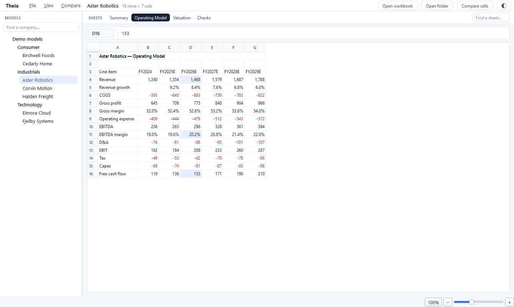
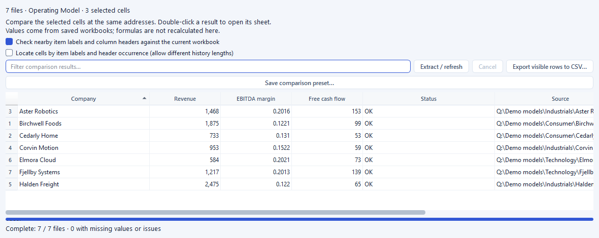

# Theia

[](
https://github.com/Hitoshi-Nakanishi/theia/actions/workflows/native-tests.yml)


[](LICENSE)

**Read Excel models and compare companies in one desktop app.**

Open a workbook, a folder of models or a zip archive. Browse sheets, inspect assumptions and compare selected metrics across
companies. Theia reads files on your disk and uploads nothing.

<picture>
  <source media="(prefers-color-scheme: dark)" srcset="docs/assets/theia-dark.png">
  
</picture>

Models in the sidebar, sheets in tabs, and the selected cell in the address bar. Screenshots use fictional demo companies.

## What you can do

- **Browse models:** open Excel files, folders and zips from the menu or by drag-and-drop.
- **Compare companies:** select cells once, extract them across workbooks, sort the results and export CSV.
- **Read familiar layouts:** keep number formats, merged cells, hidden rows, freeze panes and outline groups.
- **Make room for the data:** hide the sidebar, zoom the whole interface, and choose a light or dark theme.

## Quick start

Use Python 3.11+ in a virtual environment. From the checkout:

```sh
python -m pip install .
python -m theia examples/demo_models/0000.T_Demo_Model.xlsx
```

The included demo lets you try the viewer immediately. To open your own data, replace the demo path with a workbook, folder or
zip. Supported workbook formats are `.xlsx`, `.xls`, `.xlsm` and `.xlsb`.

With [Task](https://taskfile.dev/) installed, you can also use:

```sh
task run -- examples/demo_models/0000.T_Demo_Model.xlsx
```

Task creates the environment on its first run. Use `task run` to open your configured model folder; see
[folders and configuration](GUIDE.md#files-and-folders).

## Compare workbooks

1. Open a folder, zip or multiple files, then select the cells you want in one representative workbook.
2. Choose **Compare > Compare Selected Cells** (`Ctrl+Shift+C`). Each workbook becomes a row.
3. Sort or filter the results, export CSV, or double-click a value to open its source cell.

<picture>
  <source media="(prefers-color-scheme: dark)" srcset="docs/assets/theia-compare-dark.png">
  
</picture>

Save a comparison preset to repeat it on another collection. For models with different layouts, use label matching; see
[comparison options](GUIDE.md#comparing-models).

Theia reads saved formula results; it does not recalculate workbooks. Missing values and label mismatches are reported rather
than replaced with zero. Check units and periods before treating values as comparable.

## Documentation

- [User guide](GUIDE.md): folders, comparison rules, shortcuts and display options.
- [Contributing](CONTRIBUTING.md): development, optional acceleration and performance checks.
- [Security](SECURITY.md): handling untrusted files and reporting vulnerabilities.

[MIT License](LICENSE). See [third-party notices](THIRD_PARTY_NOTICES.md) for Qt and dependency licenses.
