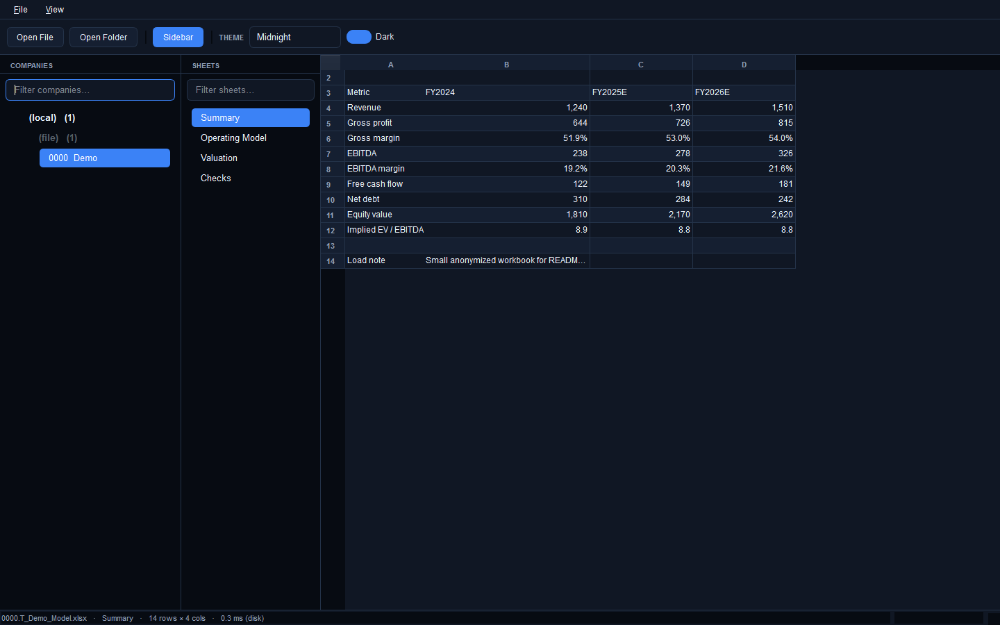

# Theia


Theia is a fast local desktop viewer for Excel valuation models. It opens a
single workbook, a folder, a zip, or a prepared archive and lets you move between
`<broker>` labels, analyst buckets, companies, and sheets without launching
Excel.



The public repository is intentionally the viewer only. Source-specific cleanup,
normalization, and export handling should live outside tracked files, for
example in the ignored `private_models/` workspace.

## Motivation

Large model workbooks are slow to open and tedious to compare. Theia keeps
the interactive part small: it renders workbooks quickly, preserves useful
spreadsheet structure, and uses optional sidecars when a private cleanup
pipeline has prepared them.

Everything runs locally against files on your own disk. Nothing is uploaded.

## Quick Start

Install [Task](https://taskfile.dev/) and Python 3.11+.

```sh
cp .env.example .env       # Windows: copy .env.example .env
# edit .env and point DATA_PATH at the root that holds your prepared archive

task install               # create .venv/ and install theia (editable)
task run                   # launch the viewer on the default prepared archive
```

You can also open anything directly:

```sh
task run-path -- /path/to/a/workbook.xlsx
task run-path -- /path/to/a/folder
task run-path -- /path/to/models.zip
```

The viewer accepts drag-and-drop of files, zips, or folders.

## Features

- Browse an archive through a three-level tree: `<broker>` -> `<analyst>` -> company.
- Open a single Excel file, a folder, or a zip by menu, CLI argument, or drag-and-drop.
- Switch between Midnight, Aurora, and Ember themes, with light and dark modes.
- Toggle the navigation sidebar when the table needs the full window width.
- Load pre-formatted `.arrow` sidecars when present for near-instant sheet display.
- Render Excel-style number formats from sidecar metadata when available.
- Preserve hidden rows/columns, merged cells, freeze panes, and outline groups.
- Use background preloading and an LRU cache so switching companies and sheets stays fast.
- Optionally compile a small Cython extension, with a pure-Python fallback.

## Demo Workbook

The repository includes an anonymized workbook for smoke tests and README
screenshots:

```sh
task run-path -- examples/demo_models/0000.T_Demo_Model.xlsx
```

The workbook and sidecar use fictional labels only. They do not contain broker
names, analyst names, client identifiers, or real holdings.

## Performance Snapshot

The numbers below are from a local smoke run against the demo workbook on
2026-07-04. They are intended as a repeatable baseline for this repository, not
as production-archive performance claims.

| Metric | Result |
|---|---:|
| Workbook size | 7,337 bytes |
| Sheets / rows / populated cells | 4 / 46 / 248 |
| Calamine workbook open, median / p95 | 0.15 ms / 0.29 ms |
| Read every visible sheet, median / p95 | 0.22 ms / 0.34 ms |
| Theia sheet display, median | 0.20 ms |
| Measurement runs | 30 |

## Private Cleanup

Keep cleanup and normalization code private. The ignored `private_models/` directory
is reserved for local scripts that may know about source-specific exports,
filename conventions, row-label mappings, or other proprietary details.

The viewer does not need those details. It only needs files it can open:

- `.xlsx`, `.xls`, `.xlsm`, or `.xlsb` workbooks
- optional `.json` metadata sidecars
- optional `.arrow` sheet sidecars

## Data Layout

By default, `task run` opens this prepared archive under `$DATA_PATH`:

```text
$DATA_PATH/
`-- broker_models/
    `-- canonical/
        `-- <broker>/
            `-- <analyst>/
                |-- <code>.T_<name>.xlsx
                |-- <code>.T_<name>.json
                `-- <code>.T_<name>.<sheet>.arrow
```

Paths are not hard-coded. `DATA_PATH` is read from the environment or `.env`.
Use `task run-path -- <path>` when you want to open a different file, folder, or
zip directly.

## Keyboard Shortcuts

| Shortcut | Action |
|---|---|
| `Ctrl+O` | Open file or zip |
| `Ctrl+Shift+O` | Open folder |
| `Ctrl+B` | Toggle sidebar |
| `Ctrl+L` | Focus the companies filter |
| `Ctrl+Shift+L` | Focus the sheets filter |
| `Ctrl+Shift+F` | Freeze panes at the current cell |
| `Ctrl+Shift+U` | Unfreeze panes |
| `Ctrl+Shift+G` | Toggle outline groups |
| `Ctrl+Arrow` | Jump to the next non-empty cell |
| `Ctrl+Shift+Arrow` | Extend the selection to the next non-empty cell |

## `task` Commands

| Command | What it does |
|---|---|
| `task` | List available tasks |
| `task install` | Create `.venv/` and install `theia` editable |
| `task paths` | Print the resolved `DATA_PATH` and archive directories |
| `task run` | Launch the viewer on the default prepared archive |
| `task run-path -- <path>` | Launch the viewer on an explicit file, folder, or zip |
| `task build-cython` | Compile the optional native accelerator |
| `task clean` | Remove `.venv/` and build artifacts |

## Optional Native Accelerator

The flat-list construction and per-cell display lookup are also available as a
small Cython extension (`theia/_arrow_fast.pyx`). It is optional:
`arrow_model.py` falls back to identical pure-Python code when the compiled
module is absent.

```sh
task build-cython
```

## Project Layout

```text
theia/
|-- app.py          # MainWindow, open file/folder/zip, <broker> -> <analyst> -> company tree
|-- table.py        # FrozenPaneTable, keyboard navigation, fast delegate
|-- model.py        # SheetModel and Excel number-format parser
|-- arrow_model.py  # ArrowSheetModel backed by a memory-mapped Arrow RecordBatch
|-- theme.py        # Theme palettes and Qt stylesheet generation
|-- _arrow_fast.pyx # optional Cython hot path
|-- workbook.py     # lazy CalamineWorkbook wrapper
`-- paths.py        # DATA_PATH and archive path resolution
```

Local private cleanup code belongs in `private_models/`, which is gitignored.

## Privacy

Theia is designed so a public checkout carries no proprietary information:

- It reads only local files and uploads nothing.
- `<broker>` labels and analyst buckets are derived from local folder names.
- `.env`, `private_models/`, and build artifacts are gitignored.

## Name

Theia does one thing: it lets you view models quickly without launching
Excel.
